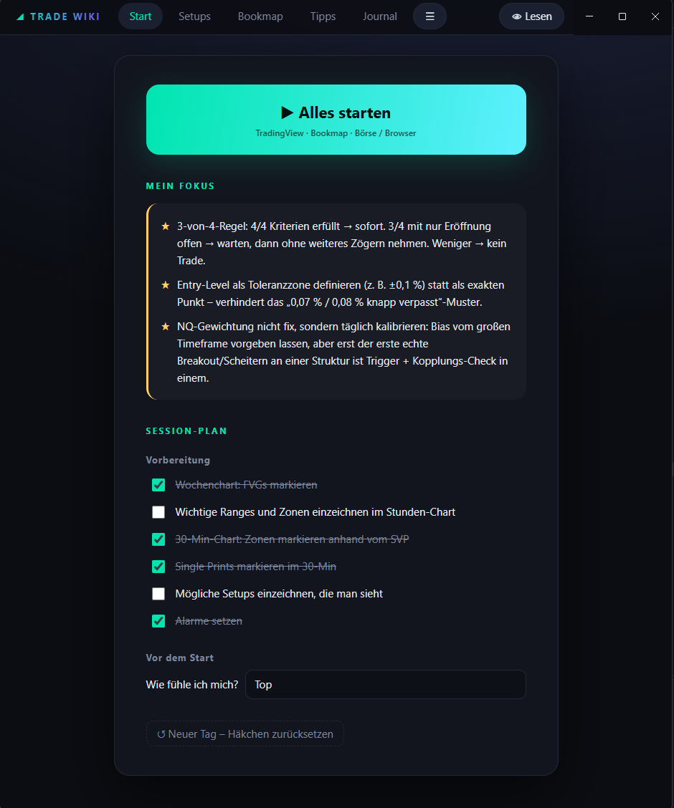
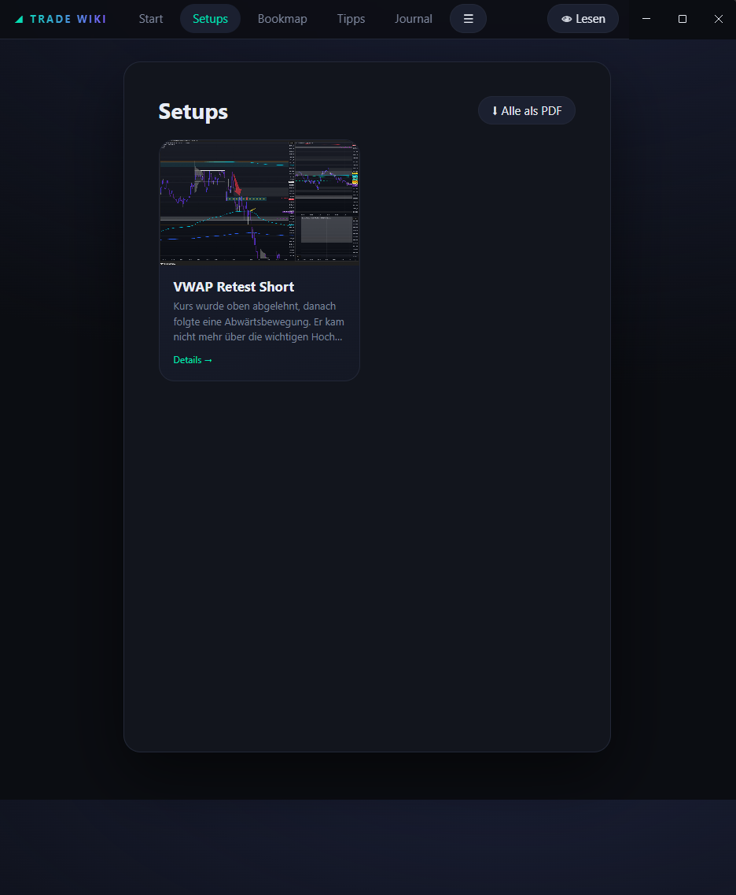
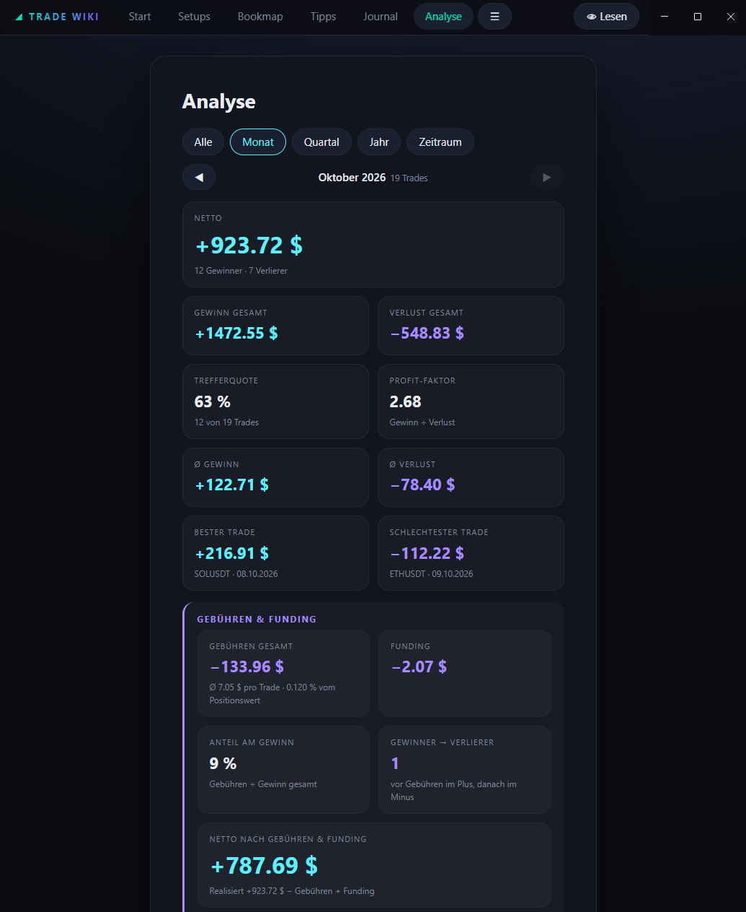

# 📈 Trade Wiki & Journal

A local, privacy-friendly desktop trading journal and personal wiki built with **Electron** and vanilla JavaScript. Made for crypto traders, with native **Bitunix Futures** import, local backups and one-click PDF reports.

> The interface is currently **German only**. An English version may follow later.

---

## 🚀 Features

- **Trading journal:** Import your closed positions from Bitunix, review every trade with its candle chart, and note whether you followed your plan.
- **Analysis:** Net result, win rate, profit factor, average win/loss, best/worst trade, fees, funding, and how many winners turned into losers after fees. Filter by month, quarter, year or custom range.
- **Chart tools:** Candlestick charts (TradingView Lightweight Charts™) with entry/exit markers, stop-loss and take-profit zones with R:R, plus drawing tools: box, line, range volume profile (VAH/VAL/POC), anchored VWAP and arrow paths.
- **Setup wiki:** Document your setups with images, entry/exit rules, confirmations and example trades. Pin your most important rules to the start page.
- **Session checklist:** A daily routine that resets itself every day, plus a one-click launcher for your trading tools.
- **PDF export:** Dark-mode A4 reports for a single trade (with chart) or your whole setup handbook.
- **Safe local storage:** Atomic writes (temp file + `fsync` + rename) with a `.prev` fallback, and automatic daily backups for the last 30 days. Manual backups to any folder.
- **Secure API keys:** Encrypted with Electron's `safeStorage` (OS-level encryption) and never shown again after saving.

---

## 📸 Screenshots

*(The screenshots show the German interface with demo data.)*

### Start page


### Setups


### Analysis


---

## 🛠️ Tech Stack

- **Desktop:** Electron
- **Frontend:** HTML5, CSS3, vanilla JavaScript (ES6+), no framework
- **Charts:** [TradingView Lightweight Charts™](https://github.com/tradingview/lightweight-charts) (Apache-2.0)
- **Security:** Electron `safeStorage` for API keys, Node.js `crypto` for signing API requests
- **Data source:** Bitunix Futures REST API (positions)

---

## ⚙️ Installation (development)

Requires [Node.js](https://nodejs.org/) (LTS recommended).

```bash
git clone https://github.com/kingnic/TradeWiki.git
cd TradeWiki
npm install
npm start
```

### Connect Bitunix

1. Create an API key in your Bitunix account. **Read-only permissions are enough** for the import.
2. Open **Einstellungen** (Settings) → **Bitunix API**, paste key and secret, and click **Speichern** (Save).
3. Go to **Journal** and click **Synchronisieren** (Sync). The first sync loads the last 90 days. Under **Einstellungen → Verlauf** (History) you can load further back, up to 2 years, as far as Bitunix provides.

---

## 💾 Your data stays with you

Everything is stored locally. The only network traffic goes to the Bitunix API.

| Mode | Location |
| --- | --- |
| Development | `./data/` |
| Packaged app | `TradeWiki-Data/` next to the executable |

The folder contains your wiki (`data.json`), your journal (`journal.json`), images, cached candles and the `backups/` subfolder. API keys are stored separately in encrypted form and are **not** part of manual backups.

---

## ⚠️ Disclaimer
This is a personal journaling tool, not financial advice. It is not affiliated with or endorsed by Bitunix or TradingView. Realized PnL is taken from Bitunix; fees and funding are shown separately and may differ from your exchange statements, so always verify important numbers on the exchange.

---
